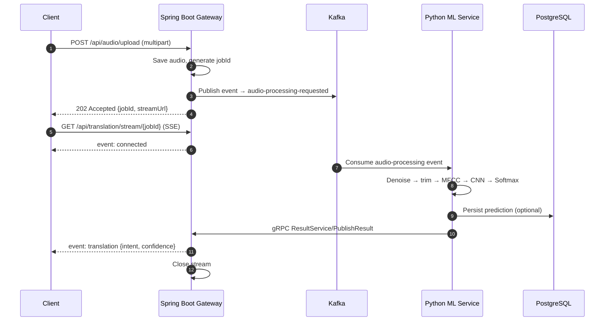

# 🐱 oreo-kitty

**An event-driven, distributed audio classification pipeline that translates raw cat vocalizations into emotional intent predictions** — using digital signal processing, deep learning, and a microservices architecture.

Upload a meow. Get back what your cat actually means — asynchronously, in real time.

---

## Table of Contents

1. [Overview](#overview)
2. [Architecture](#architecture)
3. [Tech Stack](#tech-stack)
4. [How It Works](#how-it-works)
   - [1. DSP & Deep Learning Core](#1-dsp--deep-learning-core)
   - [2. Ingestion & API Gateway](#2-ingestion--api-gateway)
   - [3. Asynchronous Messaging with Kafka](#3-asynchronous-messaging-with-kafka)
   - [4. Inter-Service Communication & Real-Time Push](#4-inter-service-communication--real-time-push)
5. [API Reference](#api-reference)
6. [Configuration](#configuration)
7. [Running End-to-End](#running-end-to-end)
8. [Quick Validation](#quick-validation)
9. [Known Limitations](#known-limitations)
10. [Roadmap: Production Target](#roadmap-production-target)

---

## Overview

| Component | Location | Responsibility |
|---|---|---|
| **Spring Boot API Gateway** | `/gateway` | Accepts audio uploads, stores them, publishes Kafka events, streams results to clients via SSE, hosts the gRPC callback server |
| **Kafka** | — | Queues audio-processing requests and decouples the gateway from ML inference |
| **Python ML Microservice** | `/ml_service` | Consumes events, preprocesses audio, extracts MFCC features, predicts intent, persists results, calls back the gateway |
| **Training Script** | `ml_service/train_cnn.py` | CNN training pipeline over MFCC inputs |

**Predicted intents**

| Intent | Meaning |
|---|---|
| `hungry_demanding` | Food-seeking / demanding vocalization |
| `content_purring` | Relaxed, content purr |
| `warning_hissing` | Defensive / territorial warning |
| `mother_kitten` | Maternal / kitten communication call |

---

## Architecture



```
 ┌────────┐  HTTP POST   ┌───────────────┐   JSON event   ┌─────────┐   consume   ┌────────────────┐
 │ Client │ ───────────▶ │ Spring Boot   │ ─────────────▶ │  Kafka  │ ──────────▶ │ Python ML      │
 │        │ ◀─ 202 + id ─│ API Gateway   │                └─────────┘             │ (librosa + CNN)│
 │        │              │               │                                        └───────┬────────┘
 │        │ ◀── SSE ──── │  SseEmitter   │ ◀──────────── gRPC PublishResult ──────────────┘
 └────────┘              └───────────────┘                                                │
                                                                                    ┌─────▼──────┐
                                                                                    │ PostgreSQL │
                                                                                    └────────────┘
```

---

## Tech Stack

| Layer | Technology |
|---|---|
| API Gateway | Spring Boot (Java), Maven |
| Messaging | Apache Kafka 4.0 (single-node KRaft) |
| ML Service | Python, `librosa`, CNN (Keras `.keras` weights) |
| Inter-service RPC | gRPC (HTTP/2) |
| Client push | Server-Sent Events (`SseEmitter`) |
| Persistence | PostgreSQL (optional, written by the ML service) |
| Containerization | Docker (Kafka today; full stack on the roadmap) |

---

## How It Works

### 1. DSP & Deep Learning Core

Rather than modelling sound as a sequential 1D waveform, the pipeline converts audio into **2D spatial representations** so an image-recognition network can classify it.

1. **Audio preprocessing** — The ML service loads raw 1D time-domain audio (`.wav`, `.flac`) and uses `librosa` to denoise, trim silence, and filter ambient static.
2. **Short-Time Fourier Transform (STFT)** — Converts the waveform from the time domain to the frequency domain by computing Fourier transforms over short, overlapping window frames.
3. **Mel scale & MFCCs** — The frequency spectrum is mapped onto the non-linear **Mel scale**, which mirrors biological pitch perception. The result is a 2D "image":
   - **X-axis** → time
   - **Y-axis** → pitch / frequency
   - **Intensity** → amplitude (dB)
4. **Convolutional Neural Network (CNN)** — Trained on these spectrogram-style features. 2D convolution kernels, pooling layers, and feature maps pick up visual acoustic signatures — e.g. the distinct slope of a hiss versus the rhythmic repetition of a purr.
5. **Softmax output** — The final dense layer converts logits into a probability vector across the four intent classes; the top class and its probability become `intent` and `confidence`.

```
 raw .wav ─▶ denoise/trim ─▶ STFT ─▶ Mel filterbank ─▶ MFCC (2D) ─▶ CNN ─▶ Softmax ─▶ {intent, confidence}
```

### 2. Ingestion & API Gateway

The Spring Boot gateway is the system's entry point and handles:

- **Multipart upload** of raw audio via `POST /api/audio/upload`
- **Payload storage** — the file is written to local storage (S3-compatible object storage is the production target)
- **Job ID generation** — each upload gets a unique ID (currently the stored file's UUID-based filename) used to track the request across every service
- **Event publication** — a job event is published to Kafka before returning `202 Accepted`

### 3. Asynchronous Messaging with Kafka

Kafka decouples short-lived HTTP requests from long-running ML work, preventing thread-pool exhaustion and enabling high concurrency.

- **Producer** — The gateway serializes the job event as JSON (`String` key, `JsonSerializer` value) and publishes it to the `audio-processing-requested` topic.
- **Consumer** — The Python ML worker pulls events from the topic at its own pace.
- **Backpressure** — If uploads spike, Kafka buffers the events safely; the ML worker is never overwhelmed and the gateway never blocks on inference.

### 4. Inter-Service Communication & Real-Time Push

Once inference completes, the result travels Python → Java → client with **no client-side polling**.

- **gRPC** — The ML service calls `oreo.gateway.ResultService/PublishResult` on the gateway (default `localhost:9090`) with `{fileId, intent, confidence}` over a multiplexed HTTP/2 connection.
- **Server-Sent Events** — The gateway holds an open, unidirectional `text/event-stream` connection per client using `SseEmitter`. On the gRPC callback it finds the emitter registered for that `jobId`, flushes the result, and closes the stream.
- **Race-free delivery** — Results that arrive *before* the client subscribes are cached per `jobId` and delivered instantly on connect, so there is no race between `202 Accepted` and a fast ML service.
- **Timeouts** — Emitters expire after **120 s**.

---

## API Reference

### `POST /api/audio/upload`

Upload an audio file (`multipart/form-data`, field name `file`). Returns **`202 Accepted`** immediately:

```json
{
  "jobId": "1c4cded3-...-5f05-81af-1efb6a560263.wav",
  "fileId": "1c4cded3-...-5f05-81af-1efb6a560263.wav",
  "status": "queued",
  "streamUrl": "/api/translation/stream/1c4cded3-...-5f05-81af-1efb6a560263.wav"
}
```

### `GET /api/translation/stream/{jobId}`

Opens an SSE connection (`text/event-stream`). The gateway sends a `connected` event, then a final `translation` event:

```
event: connected
data: {"jobId":"...","status":"listening"}

event: translation
data: {"jobId":"...","status":"completed","intent":"content_purring","confidence":0.99}
```

### gRPC: `oreo.gateway.ResultService/PublishResult`

Internal callback used by the ML service (not for external clients).

| Field | Description |
|---|---|
| `fileId` | Job identifier (matches `jobId`) |
| `intent` | Predicted intent label |
| `confidence` | Softmax probability of the predicted class |

---

## Configuration

Copy `.env.example` to `.env` and adjust. Key variables:

| Variable | Used by | Default | Purpose |
|---|---|---|---|
| `KAFKA_BOOTSTRAP_SERVERS` | gateway + ML service | `localhost:9092` | Kafka broker |
| `AUDIO_TOPIC` | gateway + ML service | `audio-processing-requested` | Upload topic |
| `GATEWAY_GRPC_PORT` | gateway | `9090` | Port of the embedded gRPC prediction callback server (`oreo.grpc.port`) |
| `GATEWAY_GRPC_TARGET` | ML service | unset | `host:port` of the gateway gRPC server; unset disables callbacks |
| `POSTGRES_DSN` | ML service | unset | Prediction persistence; unset skips the database |
| `MODEL_PATH` | ML service | `models/cat_intent_cnn.keras` | CNN weights (autoloading not wired yet) |

> The gateway's Kafka producer serializes events as JSON (String key / `JsonSerializer` value). The upload path also uses `spring.kafka.bootstrap-servers`, overridable via `KAFKA_BOOTSTRAP_SERVERS`.

---

## Running End-to-End

### 1. Start Kafka (single-node KRaft)

> ⚠️ Replication factors **must** be `1`, or `__consumer_offsets` creation will spin forever.

```bash
docker run -d --name oreo-kafka -p 9092:9092 \
  -e KAFKA_NODE_ID=0 \
  -e KAFKA_PROCESS_ROLES=controller,broker \
  -e KAFKA_CONTROLLER_QUORUM_VOTERS=0@oreo-kafka:9093 \
  -e KAFKA_LISTENERS=PLAINTEXT://:9092,CONTROLLER://:9093 \
  -e KAFKA_ADVERTISED_LISTENERS=PLAINTEXT://localhost:9092 \
  -e KAFKA_CONTROLLER_LISTENER_NAMES=CONTROLLER \
  -e KAFKA_LISTENER_SECURITY_PROTOCOL_MAP=PLAINTEXT:PLAINTEXT,CONTROLLER:PLAINTEXT \
  -e KAFKA_OFFSETS_TOPIC_REPLICATION_FACTOR=1 \
  -e KAFKA_TRANSACTION_STATE_LOG_REPLICATION_FACTOR=1 \
  -e KAFKA_TRANSACTION_STATE_LOG_MIN_ISR=1 \
  -e KAFKA_AUTO_CREATE_TOPICS_ENABLE=true \
  apache/kafka:4.0.0
```

### 2. Start the gateway (HTTP `8080`, gRPC `9090`)

```bash
cd gateway && mvn spring-boot:run
```

### 3. Start the ML service

```bash
GATEWAY_GRPC_TARGET=localhost:9090 python ml_service/app.py
```

### 4. Upload, then listen

Use two shells — or subscribe first and upload second. Both orders work.

```bash
curl -N http://localhost:8080/api/translation/stream/<jobId>
curl -F "file=@meow.wav" http://localhost:8080/api/audio/upload
```

---

## Quick Validation

Run focused unit tests for the preprocessing/inference contract:

```bash
python -m unittest discover -s tests -p "test_*.py"
```

---

## Known Limitations

- `POST /api/audio/upload` blocks up to ~60 s (`max.block.ms`) when Kafka is unreachable before failing; fail-fast (`503`) is not wired yet.
- `ml_service/app.py` has no per-message error handling — one bad message can kill the consumer loop.
- The gateway's `CnnIntentModel` is a placeholder energy-based classifier; `train_cnn.py` output is not loaded automatically.

---

## Roadmap: Production Target

The current repo is a working prototype. The following describes the intended production architecture and what is still to be built.

| Area | Today | Production target |
|---|---|---|
| **Audio storage** | Local filesystem | S3-compatible object storage; events carry a storage key/URI instead of a local path |
| **Job state** | In-memory emitters + result cache; predictions persisted by ML service | Gateway writes job metadata, session, status, and audio URL to PostgreSQL to track state transitions |
| **Event schema** | JSON | JSON or Avro with a schema registry |
| **RPC payload** | gRPC callback | Explicit Protobuf contract (`intent_label`, `confidence_score`, `job_uuid`) over HTTP/2 |
| **Resilience** | No consumer error handling; blocking producer | Per-message error handling + dead-letter topic; fail-fast `503` on Kafka outage |
| **Model** | Placeholder in gateway; weights not auto-loaded | Autoload `MODEL_PATH` in the ML service; versioned model artifacts |
| **Containerization** | Kafka only | Dockerized gateway, ML service, Kafka, PostgreSQL |
| **Orchestration** | Manual startup | `docker-compose` for local dev (networks, env injection, volumes, port mappings, dependencies) |
| **Scaling** | Single instance | Kubernetes with Horizontal Pod Autoscaling on ML worker pods, driven by CPU/GPU utilization (and ideally Kafka consumer lag) as message volume fluctuates |
